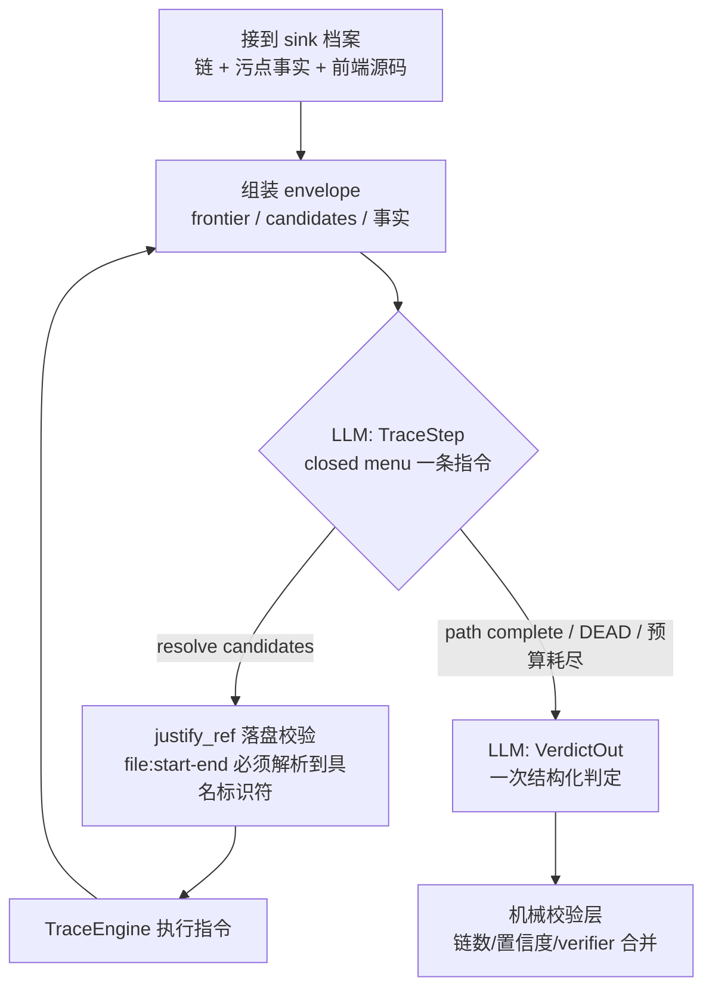

# 架构（当前实现）

> 本文描述**当前代码的实际设计**，不是方案讨论稿。历史决策见 `DECISIONS.md`，已知缺口见
> `analysis/LIMITATIONS.md`，演进记录见 `PROGRESS.md`，设计讨论稿见
> `docs/ai-sast-v2-design-discussion-draft.md`（仅历史参考，不代表现状）。

## 1. 总览

一条「确定性引擎打底、LLM 只做语义判断」的源码审计流水线：

- **Semgrep** 按语言规则扫出危险调用点（sink），保证覆盖下限；
- **Joern** 在 CPG 上做 sink→入口 的反向数据流追踪和污点确认，产出结构化链路；
- **LLM（DeepSeek，OpenAI 兼容接口，pydantic-ai 调用）** 只做两件机器做不了的事：
  给链路下语义判定（A 类），以及证明「本该存在的检查不存在」（B 类）；
- **评分与基线门禁**把每次跑批和冻结基线对比，自动归因差异（模型漂移 / 代码变更 /
  引擎变更 / 规则变更 / 真实回退）。

漏洞taxonomy 分两类，证据形态根本不同，所以是两条独立路径：

| 类别 | 内容（8/7 类） | 证据形态 | 主路径 |
|---|---|---|---|
| A 类（sink 类） | sqli / xss / cmdi / path-traversal / rce / xxe / deserialization / ssti | **存在**一条入口→sink 的污点链 | tracer 状态机 + 攻防 verifier |
| B 类（非 sink 类） | idor / business-logic / race-condition / priv-esc / mass-assignment / broken-access-control / auth-flaws | **缺席**：某入口少了本该有的检查 | judge 批量判定，或 planner→worker 假设队列 |

## 2. 仓库布局

```
targets/<name>/            # 故意含漏洞的基准项目（源文件 + ground_truth.json + GROUND_TRUTH.md）
analysis/rules/sinks-*.yml # 每语言 sink 规则（8 类 A 类模式）
analysis/joern/*.sc        # Joern 脚本：建 CPG、反向追踪、污点确认、取片段、单步追踪
agent/
  run_trace.py             # A 类入口：筛查 + tracer + verifier + 评分 + 报告
  run_baseline.py          # 基线冻结 / 门禁对比（也驱动确定性阶段 + 两个 judge）
  run_planner.py           # B 类假设队列生成（M6）
  run_worker.py            # B 类假设消费与缺席比较调查（M7）
  sast_agent/              # 核心包（见下表）
scripts/                   # 独立脚本：sink 转换、两个 LLM judge、repo-map、报告合并
tests/                     # 91 项无 LLM 测试（唯一强制性测试门槛）
workspace/                 # 全部生成产物（gitignored）：CPG、缓存、报告、基线
```

`sast_agent/` 包内分工：

| 模块 | 职责 |
|---|---|
| `config.py` / `contracts.py` | 目标清单、模型配置；Sink/Chain/TaintFlow/Finding 等数据结构 |
| `pipeline.py` | 确定性筛查：semgrep → sinks → joern CPG → 反向链 → 污点确认 → 片段抽取，逐层缓存在 `workspace/agent-cache/<target>/` |
| `tracer.py` + `trace_engine.py` + `trace_schema.py` + `trace_prompts.py` | A 类追踪状态机（见 §4） |
| `verifier.py` | 攻防两段对抗复核（见 §5） |
| `planner.py` / `worker.py` | B 类假设生成 / 缺席比较调查 |
| `tools.py` | agent 工具层（read_function / search_code / joern_query …），统一执行红线与 scrub |
| `scrub.py` | ground-truth 隔离（见 §7） |
| `report.py` | 置信度分级、verifier 合并、ground-truth 评分、Markdown 报告渲染 |

## 3. 端到端流程

```mermaid
flowchart LR
    subgraph 引擎层（确定性）
        T[targets/ 源码] --> SG[semgrep<br/>sink 规则]
        SG --> SK[sinks.json]
        T --> JP[joern-parse<br/>CPG]
        SK --> BW[backward_from_sinks<br/>sink→入口 反向链]
        JP --> BW
        BW --> TC[taint_confirm<br/>污点确认]
        TC --> CS[extract_chain_snippets<br/>链路源码片段]
    end

    subgraph A 类判定
        CS --> TR[tracer 状态机<br/>逐 sink 续链 + 语义判定]
        TR --> VF[verifier<br/>attacker / defender 两段复核]
    end

    subgraph B 类判定
        EP[extract_entrypoint_snippets<br/>入口 + 前向可达片段] --> BJ[judge / worker<br/>缺席证明]
    end

    BW --> EP
    VF --> SC[score_findings<br/>对照 ground_truth 评分]
    BJ --> SC
    SC --> RP[report.md + summary.json]
    RP --> GT[run_baseline --compare<br/>基线门禁]
```

一次完整跑批（`run_trace.py --target <name>`）的阶段：

1. **筛查（确定性，pipeline.py）**：semgrep 按规则出 sink 清单；joern 建 CPG 后跑
   `backward_from_sinks.sc` 做反向追踪，每个 sink 得到若干条「入口→…→sink」链，
   追不动时记录 `dead_end`（停滞方法 + 未解析调用）；`taint_confirm.sc` 在每条链上做
   数据流污点确认；`extract_chain_snippets.sc` 抽出链上每个方法的源码片段。
2. **判定（LLM）**：优先走 tracer 状态机（§4）；批量基线走 `llm_judge_sink_chains.py`
   直接逐链判定（便宜，用于冻结基线）。
3. **复核（LLM）**：每个 vuln 判定过 verifier 攻防两段（§5）。
4. **评分（确定性）**：`score_findings` 把判定映射回 ground-truth 条目，算召回/
   误报/置信度分级，渲染报告。
5. **门禁**：`run_baseline.py --compare <summary.json>` 与冻结基线对比（§8）。

## 4. A 类：tracer 追踪状态机

核心设计：**编排器拥有全部状态并亲自执行引擎步骤，LLM 每轮只回答一个结构化
TraceStep**。没有工具调用的 LLM、没有 joern 语法进 prompt、没有全历史回放——
LLM 调用数 ≈ 追踪步数 + 1 次判定，而旧的自由 agent 设计每个 sink 要几十轮工具往返。



**封闭指令菜单**（LLM 只能从中选一条，每轮至多一条）：

| 指令 | 执行者 | 用途 |
|---|---|---|
| `callers_of` / `find_call_sites` | joern `trace_step.sc` | 找上游调用方 / 注册回调点 |
| `trace_back` / `writes_to` / `reads_of` | joern `trace_step.sc` | 沿数据流回溯 / 找读写点 |
| `methods_in_file` | joern `trace_step.sc` | 列文件内方法 |
| `read_file` / `search_code` | SastTools | 读源码 / 全库搜索（继承红线与 scrub） |

**护栏**（都在 `tracer.py`，全是机械检查，不靠 LLM 自觉）：

- 每个 `llm_inferred` 跳点必须带 `justify_ref: "file:start-end"`，且必须能解析到具名
  标识符，否则判定降级——LLM 编的跳点无效；
- 说 DEAD 之前必须先试过 `find_call_sites` / `search_code`，否则拒收；
- 无进展检测器 + 每 sink 步数预算（12 步），烧完预算诚实降级，不硬撑；
- 一个 sink 有多条引擎链时逐链判定，vuln 判定必须指明 `exploitable_chain`
  （1 起编号），评分和 verifier 锚定这条链而不是种子最长链；
- 连续 joern 失败触发引擎降级：停止再起 JVM，用已收集的上下文收尾并降低置信度。

## 5. 攻防 verifier

每个 vuln 判定都过**两个独立的新鲜 agent 实例**（看不到追踪 agent 的历史）：

- **attacker**：构造具体触发请求（HTTP 方法/路径/参数，或非 HTTP 的触发器报文），
  逐跳走到 sink；构造不出来 → 判定降级（`report.apply_verifier` 执行）；
- **defender**：在路径上找有效的净化/鉴权/类型约束，给出 file:line；找到且可解析
  → 否决（判定翻转为 not vulnerable）。

两个角色只能用 `read_function` / `search_code`，不能用 joern。本模块只产出两份报告，
合并是机械逻辑——verifier 超时/报错永远不会自己翻转判定。

## 6. B 类：缺席证明的两条路径

B 类的证据形态是「某入口少了本该有的检查」，所以既有批量便宜的 judge 层
（基线用它），也有更贵的 agent 路径：

- **judge 层（`llm_judge_entrypoints.py`，基线路径）**：`extract_entrypoint_snippets.sc`
  抽出每个入口 handler + 前向可达方法源码，judge 对照 7 个非 sink 类逐入口语义判定。
- **agent 路径（`run_planner.py` → `run_worker.py`）**：planner 读 tree-sitter
  repo-map（`scripts/repo_map.py` 出的路由表 + 符号摘要），产出「该入口可能缺什么检查」
  的假设队列到 `workspace/agent-cache/<target>/hypotheses.jsonl`；worker 每假设一个
  agent，用**缺席比较法**调查：前向切片 → 找本该存在的检查 → 找不到就在全库搜同类
  惯用法 → 兄弟路由有、这条没有 = 缺席成立；全库都没有 = 去查 app 初始化/中间件；
  检查在 = not vulnerable。

## 7. ground truth 隔离

`ground_truth.json` / `GROUND_TRUTH.md` 是唯一的事实来源，但 agent 工具层**读不到
它们**（硬拒绝）；源码里自 2026-09-26 起无任何 `VULN:`/`SAFE:` 标记（反过拟合，
DECISIONS.md D15）。`scrub.py` 是唯一清洗器：所有进 prompt 的源码先剥离已知标记
形状，再断言无残留——坐实命中直接抛 `GroundTruthLeak` 让本次运行失败并记入
`workspace/leak-audit.jsonl`；疑似（裸 `<lang>-<type>-<nn>` 形 id）只审计不拒跑。
judge 脚本带 `--check-leak` 可以离线（无 API key）校验所有 prompt。

## 8. 评分与基线门禁

- **对账**：`chain_matches_entry` 先按类型标签匹配 sink；类型不一致时回退到精确位置
  匹配（同文件 + 链路终点方法 == ground-truth sink 函数）——同一个物理 sink 可能
  横跨两类（如脚本引擎求值既可记 rce 也可记 ssti，2026-11-04 修复）。
- **置信度（机械映射，永不 LLM 填）**：CONFIRMED（vuln 且证据 refs ≥ 2）/ LIKELY /
  SUSPICIOUS（not-vuln 不进评分）。
- **基线**：`run_baseline.py` 逐阶段把产物（semgrep 输出、sinks、CPG、链、污点、
  片段、两个 judge 的 verdicts）落到 `workspace/baseline/<target>/`，汇总进
  `baseline.json`（v2：含模型版本、引擎/judge 脚本指纹等 provenance）。
  **改规则后重跑必须 `--force`，且 tracer 的 `workspace/agent-cache/<target>/` 要手动清**
  （阶段缓存不感知规则变化，2026-11-04 踩坑记录）。
- **门禁**：`--compare <summary.json>` 逐项对比，PASS / SKIP（不可比）/ FAIL，
  FAIL 必归因：MODEL_DRIFT / CODE_CHANGED / SNIPPET_CHANGED / ENGINE_CHANGED /
  JUDGE_CHANGED，都不是才算 REAL_REGRESSION。

## 9. 非 HTTP 目标：注册表分发约定

`java-fix-gateway` / `python-clearing-worker` 是证券业消息/文件驱动场景，没有 HTTP
路由。入口写成注册表形状（**必须**是注册表，不能是 switch——tree-sitter 和 Joern
都要看得见）：

| 注册写法 | 触发器描述符 | ground-truth `entrypoint.route` |
|---|---|---|
| `router.register("D", fn)` | 命令 | `CMD D` |
| `bus.subscribe("subj", fn)` | 消息 | `MSG subj` |
| `watcher.watch(dir, fn)` | 文件投放 | `FILE dir` |

7 个 joern 脚本内置同一套注册表扫描（resolveHandler 先 methodRef 后按名兜底），
注册 handler 的参数作为污点源。已知残留：repo-map 的 `--check` 和 M6 覆盖率检查仍按
HTTP 路由形状比对，触发器会记为路由 miss（函数命中不受影响），见 LIMITATIONS.md。

## 10. 命令行入口

| 命令 | 用途 |
|---|---|
| `uv run --offline agent/run_trace.py --target <name\|all> [--limit N] [--only-sink X] [--dry-run]` | A 类 tracer 跑批；`--dry-run` 零 LLM 冒烟 |
| `python3 agent/run_baseline.py [--targets a,b] [--force] [--collect-only]` | 冻结 / 重冻结基线 |
| `python3 agent/run_baseline.py --compare <summary.json>` | 门禁对比 |
| `python3 agent/run_planner.py --target <name>` / `run_worker.py` | B 类假设队列 / 调查 |
| `uv run scripts/llm_judge_sink_chains.py --snippets <f> --ground-truth <gt> [-o out]` | A 类批量 judge（基线路径） |
| `uv run scripts/llm_judge_sink_chains.py --check-leak ...` | 离线 prompt 泄漏自检（CI 可跑） |
| `uv run scripts/repo_map.py <tree> [--check ground_truth.json]` | tree-sitter repo-map |
| `uv run --with pytest ... pytest tests -q` | 91 项无 LLM 测试（任何改动的强制门槛） |

## 11. 当前实测状态（2026-11-04）

5 个引擎目标（python-flask / java-spring / js-ts-express / java-fix-gateway /
python-clearing-worker）A 类召回 judge 与 tracer 双双 10/10，安全样本误报 0，
门禁 PASS。污点确认：java-fix-gateway 11/14、python-clearing-worker 5/16
（pysrc2cpg 对 dict/下标 DFG 丢失的已知限制，由 tracer 运行时续链兜底）。
B 类 judge 层：6/7 与 7/7；B 类 worker 路径未在两个非 HTTP 目标上跑过。
`perl-cgi` 是刻意的无引擎 tier-3（semgrep/joern 都不支持 Perl）。完整清单见
`analysis/LIMITATIONS.md`。
