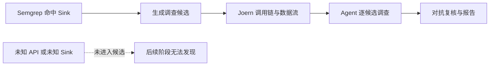
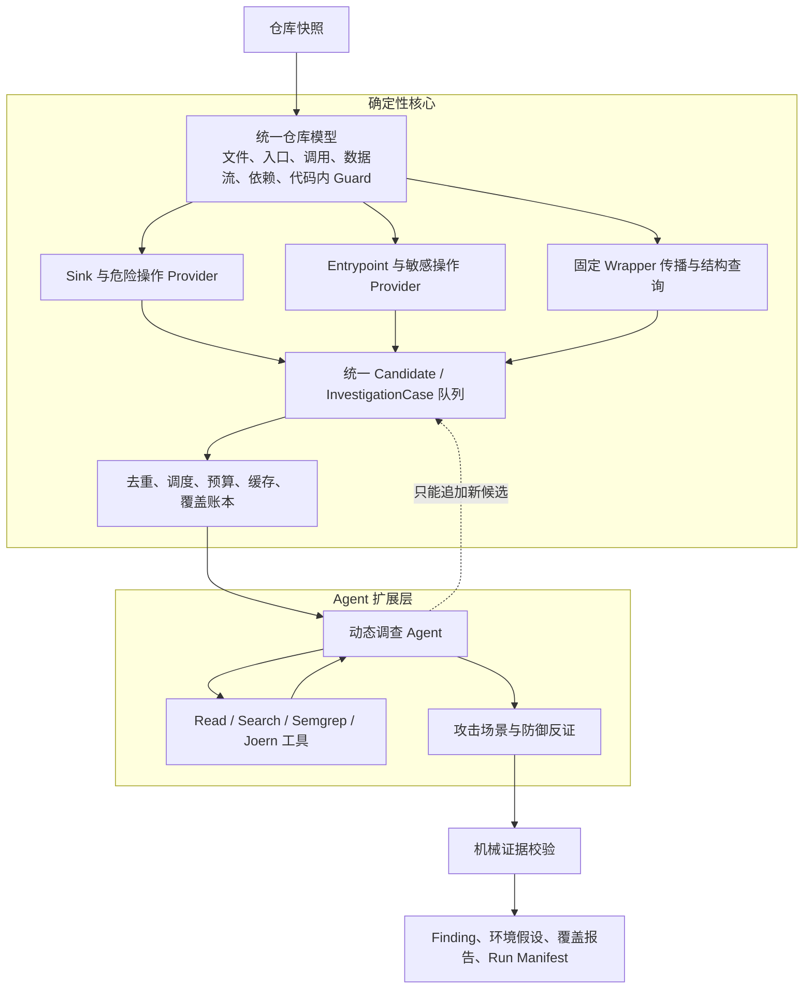
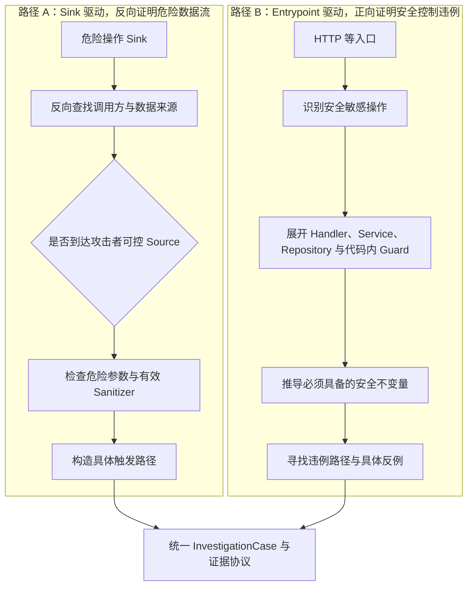
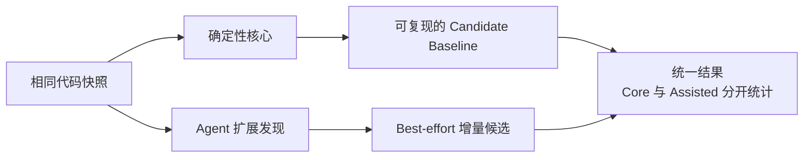

# AI SAST 重新设计讨论稿

> **状态：讨论稿 v0.1，不是最终决策**  
> 日期：2026-10-24  
> 用途：整理近期讨论形成的设计倾向、备选方案和未决问题，供继续 review、修改与取舍。  
> 阅读建议：先看“一页摘要”和核心架构图；涉及具体范围与技术选型的部分都可以单独推翻，不影响其他章节继续讨论。

---

## 0. 一页摘要

### 0.1 当前讨论形成的基本方向

我们希望重新设计一个**面向第一方源代码的 AI SAST**，核心目标是：

> 从源代码出发，证明攻击者可控的输入、身份或操作序列，如何使代码违反明确的安全性质；不评估代码之外的部署、基础设施和运行环境。

当前倾向可以概括为下面六句话：

| 方面 | 当前倾向，尚未定案 |
|---|---|
| 产品边界 | 只关注代码本身的漏洞，不做部署、外部配置、SCA 和运行时安全评估 |
| 系统结构 | 确定性核心负责覆盖下限，Agent 负责语义理解和增量发现 |
| 扫描路径 | Sink 反向追踪与 Entrypoint 正向分析并存，必要时混合 |
| 漏洞表达 | CWE 对齐的根因 + 安全不变量 + 证据要求，根因与影响分离 |
| 标准使用 | Code-Level CWE Profile 是内部范围；OWASP 仅作可选报告映射 |
| 技术实现 | 倾向 Pydantic AI 作为 Agent runtime，自研显式编排与状态存储 |

### 0.2 最重要的设计变化

旧思路更接近：

```text
Semgrep 找到 sink → Joern 补链 → LLM 判断已有候选
```

新思路希望变成：

```text
确定性系统建立候选和覆盖下限
                +
Agent 从入口、源码和工具结果中增量发现与调查
                ↓
       统一证据、反证和覆盖报告
```

### 0.3 一句话理解整个方案

> **不是让 LLM 取代 SAST，而是让确定性引擎负责“不能漏掉已知范围内的工作”，让 Agent 负责“理解代码、处理未知和补足证据”。**

---

## 1. 为什么需要重新设计

### 1.1 当前实现已经具备的能力

现有项目并不是简单的固定流水线。它已经能够：

- 使用 Semgrep 发现已知形态的 sink；
- 使用 Joern 获取调用链、数据流和源码片段；
- 在断链或数据流无法确认时，由 Agent 调用代码搜索、源码读取和 Joern 查询继续调查；
- 从 HTTP 入口进行 B 类逻辑漏洞分析；
- 使用 attacker／defender 角色做对抗复核；
- 用 ground truth、SAFE 样本和回归门禁评价结果。

这些能力应作为新系统的资产，而不是全部推倒。

### 1.2 真正的结构性问题

当前 A 类扫描的主要入口仍然是 Semgrep：



这带来一个明确限制：

> 如果候选从未进入队列，后面的 Joern 和 LLM 再强，也没有机会发现它。

需要区分两类“未知仓库”：

1. **仓库是新的，但框架和危险 API 已知**：现有规则可能仍然有效。
2. **仓库使用未知 API、内部 wrapper、动态调用或新的危险操作**：仅依赖预写规则容易漏检。

目标不是消灭规则，而是：**扫描新仓库时，不依赖事先为这个仓库编写规则。**

### 1.3 另一个问题：漏洞类型与扫描方式绑定过紧

当前约定大致是：

- A 类：sink-based；
- B 类：non-sink、entrypoint-driven。

这适合早期 benchmark，但不适合长期作为漏洞本体分类。因为：

- 文件上传同时涉及文件 sink、访问控制和执行路径；
- 存储型 XSS 同时涉及入口、存储过程和输出 sink；
- Mass Assignment 既是数据流问题，也可能造成权限提升；
- IDOR、Broken Access Control 和 Privilege Escalation 存在根因与影响上的重叠。

因此，新设计需要把“是什么漏洞”和“怎样发现它”分开。

---

## 2. 产品范围：只做代码级漏洞

### 2.1 建议的产品定位

暂定名称：

> **Code-Level AI SAST：面向第一方源代码、证据驱动的静态安全分析工具。**

这里的“代码级”不是“只做文本匹配”，而是指：漏洞成立所需的关键事实，应能从应用源代码、代码内调用关系和代码语义中建立。

### 2.2 范围内与范围外

| 范围内 | 范围外 |
|---|---|
| 第一方应用源代码 | 部署与服务器配置 |
| 代码中的调用链、数据流和状态变化 | IaC、容器、云权限和网络策略 |
| 代码实现的认证、授权与业务约束 | TLS、WAF、网关与运行时防护 |
| 代码内危险 API 及其参数 | 第三方组件版本与 CVE，即 SCA |
| 代码内 middleware、decorator、guard | 外部日志、监控、告警和响应能力 |
| 代码可证明的安全缺陷 | 外部 CORS、Cookie、安全配置检查 |

### 2.3 “代码内安全参数”仍然属于代码

下面这类写法虽然有配置语义，但行为直接由源代码决定，仍应纳入：

```python
XMLParser(resolve_entities=True)
subprocess.run(cmd, shell=True)
pickle.loads(data)
jwt.decode(token, options={"verify_signature": False})
```

相反，`nginx.conf`、部署 YAML、环境变量和网关策略不属于当前核心范围。

### 2.4 代码漏洞不等于所有影响都能由代码证明

例如：

- SSRF 的代码路径成立，不代表已经证明能访问某个具体内网服务；
- 文件上传的代码缺陷成立，不代表任何部署下都能直接 RCE；
- 竞争条件的代码缺陷成立，不代表已经实测其运行时触发概率；
- CSRF 的代码分析可以成立，但实际影响仍依赖认证和浏览器上下文。

因此 Finding 需要分别表达：

```text
代码缺陷是否成立
攻击者可达路径是否已在代码中证明
实际影响依赖哪些未评估的环境条件
```

---

## 3. 总体架构：确定性核心 + Agent 扩展层



### 3.1 确定性核心负责什么

- 固定枚举仓库文件、入口、调用和依赖；
- 运行已知 Semgrep 规则与其他候选 Provider；
- 对已知 sink 做确定性的 wrapper 反向传播；
- 去重、调度、预算、缓存和状态流转；
- 记录候选来源和覆盖情况；
- 校验 Finding 中的文件、行号和代码证据；
- 保存 run manifest 与 candidate manifest，支持重放。

### 3.2 Agent 扩展层负责什么

- 理解陌生 API 和代码语义；
- 识别安全敏感操作并推导安全不变量；
- 动态选择 read、search、Semgrep、Joern 等工具；
- 修复调用链或数据流断点；
- 判断 sanitizer、guard 是否真正有效；
- 构造攻击场景，并主动寻找防御反证；
- 提议新候选，但不能删除或否决确定性核心已经发现的候选。

### 3.3 为什么不是完全自治 Agent

完全由 Agent 决定“看哪些文件、生成哪些规则、何时停止”，会带来：

- 候选集合不可复现；
- 覆盖范围无法审计；
- 成本和运行时间不稳定；
- 模型漂移直接影响发现能力；
- 很难区分“没有漏洞”和“没有检查到”。

因此，当前倾向是：**扫描调度由系统掌握，局部调查路径由 Agent 掌握。**

---

## 4. 两条主要扫描路径



### 4.1 路径 A：证明“危险路径存在”

典型例子：SQL 注入。

```text
GET /users?name=...
        ↓
用户控制的 name
        ↓
服务层传递与字符串拼接
        ↓
db.query(sql)
        ↓
没有参数化或其他有效查询分离
```

它要回答：

- Source 是否真的由攻击者控制？
- 数据是否到达 sink 的危险参数？
- 调用链是否可达？
- Sanitizer 是否对这种 sink 和上下文真正有效？

适合的漏洞包括 SQLi、XSS、CMDi、代码注入、路径穿越、SSRF、SSTI 等。

### 4.2 路径 B：证明“必要控制缺席或可被绕过”

典型例子：IDOR。

```text
GET /orders/{order_id}
        ↓
当前用户已登录
        ↓
order_id 由用户控制
        ↓
直接读取并返回订单
        ↓
没有建立“当前用户可操作该订单”的授权事实
```

它要回答：

- 当前主体是谁？
- 被操作的对象是什么？
- 操作为什么敏感？
- 应当满足什么授权或业务不变量？
- 这个保证在 handler、service、repository、middleware 的哪一行建立？
- 能否构造一个具体的跨用户或越权反例？

### 4.3 两条路径的对比

| 维度 | Sink 驱动 | Entrypoint 驱动 |
|---|---|---|
| 起点 | 危险操作 | 外部入口与安全敏感操作 |
| 搜索方向 | 主要反向 | 主要正向 |
| 核心证据 | Source → Sink 的数据流 | Operation → Invariant 的违例 |
| 典型问题 | 注入、路径穿越、SSRF | 越权、CSRF、认证和业务约束 |
| 主要盲区 | 未识别 sink 就没有候选 | 安全要求不明确时容易误判“缺少检查” |
| Agent 的主要价值 | 续链、语义判断、陌生 API | 推导安全性质、分析 guard、构造反例 |

### 4.4 A/B 应是扫描策略，不再是漏洞本体分类

以下问题需要混合路径：

- 存储型 XSS；
- 文件上传；
- Mass Assignment 导致权限提升；
- 一个入口存储数据、另一个入口触发危险操作；
- IDOR 读取敏感文件。

所以新系统允许：

```text
scan_strategy = sink / entrypoint / hybrid
```

两条路径最终使用同一套 InvestigationCase、Evidence 和 Finding 契约。

---

## 5. 确定性到底能保证什么

### 5.1 两个不同目标

**可复现性**：同一份代码和同一套固定配置，多次运行得到相同结果。  
**召回保证**：所有真实漏洞都能被发现。

LLM 参与发现会削弱前者；但即使纯规则系统，也只能保证已知规则和已知模型范围内的覆盖，不能保证所有未知漏洞都被发现。

### 5.2 推荐的确定性承诺

> 相同代码快照 + 相同规则 + 相同引擎版本，至少得到相同的确定性候选基线。



### 5.3 Core 与 Assisted 必须分开

| 维度 | Core | Assisted |
|---|---|---|
| 候选来源 | 固定规则、固定算法、结构枚举 | Agent 语义推断与动态提议 |
| 是否可复现 | 在版本冻结后应可复现 | 不承诺每次一致 |
| 是否可作为稳定覆盖下限 | 是 | 否 |
| 是否允许过滤 Core 候选 | 不适用 | 不允许 |
| 报告标识 | `CORE` | `ASSISTED` |
| 评价方式 | 回归、覆盖率、FP | 增量召回、稳定性、成本 |

### 5.4 两种运行模式，待评审

| 模式 | 用途 | 当前设想 |
|---|---|---|
| 审计模式 | CI、回归、可复现报告 | 固定规则与算法，冻结候选及必要的 LLM 响应缓存 |
| 探索模式 | 新仓库、未知 API、提高覆盖 | 允许 Agent 追加候选，单独标记与统计 |

注意：冻结候选只能让“候选发现”可复现；如果要求端到端完全可复现，还需要冻结或重放 LLM 的判定结果。

---

## 6. 漏洞类型：重定义表达模型，不重发明行业名称

### 6.1 当前建议

> CWE 用作技术弱点坐标，安全不变量用作分析核心，证据模型用于驱动调查，OWASP 用作可选报告映射。

不建议创建一套与 CWE／OWASP 完全平行的新命名体系。

### 6.2 每类弱点需要的最小信息

```yaml
id: idor
cwe: CWE-639
security_invariant: >
  当前主体必须被授权对目标对象执行当前操作。
scan_strategy:
  - entrypoint
required_evidence:
  - attacker_controlled_object_reference
  - sensitive_object_operation
  - missing_or_bypassable_object_authorization
  - concrete_cross_subject_scenario
impact:
  - unauthorized-data-access
owasp_mapping: optional-versioned-metadata
```

这里各字段回答不同问题：

| 字段 | 回答的问题 |
|---|---|
| `id` / `cwe` | 这是什么技术弱点 |
| `security_invariant` | 正常代码本来必须保证什么 |
| `scan_strategy` | 可以从哪里、沿什么方向调查 |
| `required_evidence` | 什么证据齐全后才能判定 |
| `impact` | 可能造成什么影响 |
| `owasp_mapping` | 报告中如何归类，不影响扫描核心 |

### 6.3 代码级范围内使用三种主要证据模型

| 证据模型 | 需要证明什么 | 典型例子 |
|---|---|---|
| 数据流违例 | 不可信数据到达危险操作且未被有效处理 | SQLi、XSS、SSRF |
| 控制／不变量违例 | 必要授权、请求意图或业务控制缺席或可绕过 | IDOR、CSRF、Mass Assignment |
| 状态／时序违例 | 特定并发、重放或调用顺序破坏状态约束 | Race Condition、重复消费、状态机绕过 |

实际 Finding 可以组合多种证据模型。

### 6.4 根因与影响分离

例如：

```text
root_cause = mass-assignment
impact     = priv-esc
```

以及：

```text
root_cause = unsafe-deserialization
impact     = rce
```

这样可以减少同一根因因多个影响被重复计数。

### 6.5 Sink 不再与漏洞类型一一绑定

同一个危险操作可以产生不同假设：

| 危险操作 | 可能的漏洞假设 |
|---|---|
| `open(path)` | 路径穿越、任意文件读取、任意文件写入 |
| `fetch(url)` | SSRF、敏感数据外发 |
| `res.send(html)` | XSS、敏感信息泄露 |
| `update(user, fields)` | Mass Assignment、IDOR、权限提升 |

因此引擎首先识别“危险能力”，再结合上下文生成漏洞假设，而不是规则命中时就永久决定漏洞类型。

---

## 7. 范围标准：Code-Level CWE Profile

### 7.1 OWASP Top 10 与 CWE Top 25 怎么用

| 标准 | 优点 | 不适合直接承担的工作 | 当前建议 |
|---|---|---|---|
| OWASP Top 10:2025 | 高层风险沟通、报告归类 | 直接推导统一检测算法 | 可选报告映射，不作完整覆盖承诺 |
| CWE Top 25:2025 | 更接近具体根因，便于定义样本与证据 | 含内存安全和宽泛父类，不宜全量照搬 | 选择代码级 Web 子集作为核心参考 |
| Code-Level CWE Profile | 范围精确、符合产品边界 | 需要自己维护版本和映射 | 作为内部实际检测范围 |

### 7.2 第一版范围草案

当前讨论倾向于：**迁移现有 15 类的代码级能力，新增 SSRF 与 CSRF，其余类型暂缓。**

| 检测线 | 暂定场景 | 主要策略 |
|---|---|---|
| 注入与危险数据流 | SQLi、XSS、CMDi、代码注入、路径穿越、不安全反序列化、XXE、SSTI，新增 SSRF | Sink + 数据流 |
| 授权、认证与请求完整性 | IDOR、Broken Access Control、Mass Assignment、认证缺陷，新增 CSRF | Entrypoint + 安全不变量 |
| 业务与状态约束 | 金额／数量约束、优惠券重用、状态流转、竞争条件 | Entrypoint + 状态／时序分析 |

Privilege Escalation、RCE 等是否继续作为独立类型，还是逐步改为影响标签，留待 review。

### 7.3 暂不扩展的方向

- 文件上传、信息泄露、资源消耗；
- NoSQLi、开放重定向、Prototype Pollution、ReDoS；
- 内存安全 CWE；
- 完整密码学、密钥管理和随机性评估；
- 部署、外部配置、SCA、日志与运行时监控。

这些不是永远不做，而是不进入第一版核心承诺。

### 7.4 覆盖率必须按明确 Profile 计算

推荐分别统计：

```text
Code-Level Core：选定的 CWE Top 25 代码级 Web 子集
Project Extended：SSTI、XXE、Business Logic、Race 等扩展能力
Out of Scope：部署、配置、SCA、当前不适用 CWE
```

避免使用“覆盖 OWASP Top 10”或“覆盖 CWE Top 25”这种无法准确说明边界的宣传口径。

---

## 8. Semgrep、Joern 与 LLM 的新角色

| 组件 | 不再承担 | 推荐角色 |
|---|---|---|
| Semgrep | A 类唯一候选入口、漏洞最终判定者 | 已知模式的低成本 Candidate Provider、局部结构匹配工具 |
| Joern | 所有语言与流程都不可缺少的固定主干 | 调用图、数据流、结构查询、断点现场和证据工具 |
| LLM / Agent | 自由决定整个扫描范围、无依据地输出漏洞名 | 语义理解、动态调查、增量发现、反证和安全性质推理 |
| 自研 Workflow | 简单串起固定脚本 | 覆盖、调度、去重、预算、缓存、恢复、审计与报告 |

### 8.1 Wrapper 应优先用确定性传播解决

如果已知：

```text
connection.execute 是危险 sink
run_raw() 调用 connection.execute
search() 调用 run_raw()
```

则可以沿调用图固定反向传播：

```text
connection.execute → run_raw → search
```

这能在不引入 LLM 不确定性的情况下发现内部 wrapper。Agent 只在动态分派、反射、未知语义等情况下补充。

### 8.2 Agent 提议的新候选要尽量固化

Agent 提议新 sink 或 wrapper 时，应记录：

- 文件、行号和函数；
- 危险能力及疑似弱点；
- 支持它的源码证据；
- 可重复执行的 AST、CPG 或 Semgrep 查询；
- `ASSISTED` 来源标识。

第一次发现可以是不确定性的；后续审计应尽量基于冻结的 manifest 和可执行查询重放。

---

## 9. 技术框架与新项目隔离

### 9.1 框架选型仍属讨论项

| 方案 | 适合的角色 | 当前评价 |
|---|---|---|
| Pydantic AI | 单候选调查、工具循环、结构化输出、模型抽象 | 当前倾向；与 Python 和 Pydantic 契约最一致 |
| LangGraph | 有状态工作流、checkpoint、interrupt、人工介入 | 当恢复与人工工作流成为核心时再考虑；不会自动带来确定性 |
| Pi | 交互式 coding agent、终端会话和人工调查工作台 | 暂不作为扫描内核；可作为未来交互前端 |

当前主要建议是：

> **Pydantic AI 只出现在 Agent adapter 层，扫描核心不依赖任何 Agent 框架。**

### 9.2 建议的模块边界

```text
domain/        Candidate、Case、Evidence、Finding、Invariant 等纯契约
engines/       Semgrep、Joern、tree-sitter 等独立适配器
tools/         框架无关的普通 Python 工具函数
workflow/      确定性编排、候选状态机、调度、预算与覆盖
agents/        唯一允许依赖 Pydantic AI 的层
storage/       Manifest、SQLite、artifact store、缓存与重放
evaluation/    Ground truth、SAFE 样本、新旧系统对比与指标
```

依赖原则：

```text
domain / engines / workflow 不依赖 Agent 框架
agents 只通过接口调用 domain 与 tools
```

### 9.3 不污染现有实现

优先讨论新开独立仓库；若必须同仓，则使用完全独立的新包和输出目录。

无论采用哪种方式，建议：

- 不 import 现有 `agent/sast_agent/`；
- 不修改现有 pipeline 和报告；
- 现有 targets 只读复用；
- 复用规则、Joern 脚本和 benchmark 资产，而不是复制旧编排；
- 新旧系统独立运行、独立评分，再做结果对比。

---

## 10. 如何衡量新设计是否更好

不能只看最终 recall。至少要分阶段观察：

| 指标 | 回答的问题 |
|---|---|
| Candidate Recall | 真实漏洞是否曾进入调查队列 |
| Provider Contribution | 哪类 Provider 独立贡献了候选 |
| Final Recall / FP | 最终检出与误报表现如何 |
| SAFE Near-miss | 是否真正理解 sanitizer、guard 和安全近似代码 |
| Core / Assisted Delta | Agent 究竟增加了多少覆盖 |
| Replay Consistency | 冻结条件下能否复现候选和结果 |
| Coverage Ledger | 哪些文件、入口、候选被检查或跳过，原因是什么 |
| Tokens / Latency | 新增覆盖付出了多少成本 |
| Evidence Validity | 文件、行号、调用关系和证据是否可核查 |

### 10.1 Benchmark 不应只按漏洞数量设计

还应主动覆盖不同能力形态：

- 直接与跨文件数据流；
- 字段、模块变量和存储型数据流；
- 已知与未知 wrapper；
- 有效与无效 sanitizer；
- 对象级、功能级、字段级授权；
- middleware 中存在的 guard；
- 并发、重放和状态机约束；
- 高质量的 SAFE 近似样本。

### 10.2 建议的实施顺序，不是排期承诺

| 阶段 | 主要产出 |
|---|---|
| 0. Scope Review | 冻结第一版范围、排除项和未决问题 |
| 1. Domain + Core | 纯契约、Candidate、确定性 Provider、Manifest，不接 LLM |
| 2. Sink Investigation | 一个 Pydantic AI investigator 跑通统一证据协议 |
| 3. Entrypoint Investigation | 跑通安全不变量与代码内 guard 分析 |
| 4. Assisted Discovery | Agent 只能追加候选，Core／Assisted 分开统计 |
| 5. Evaluation | 新旧实现对比、未知仓库验证、成本与可复现性评估 |

---

## 11. 需要你重点 review 的未决问题

以下问题不应被这份讨论稿默认为已经决定。

### 11.1 范围问题

1. 第一版是否就采用“现有 15 类迁移 + SSRF + CSRF”？
2. 文件上传是否因为能锻炼混合证据而提前，还是继续推迟？
3. CWE-306（关键功能缺少认证）是否需要作为独立场景加入？
4. 信息泄露是否属于第一版代码级范围，还是因其语义过宽而推迟？
5. 是否完全不做任何外部配置，还是只允许读取它们来防止误判、但不单独报告配置问题？

### 11.2 判定与证据问题

6. “代码缺陷成立”和“实际可利用”应如何分级表达？
7. 当外部运行环境可能提供防护时，Finding 应标为 uncertain、environment-dependent，还是不报告？
8. 去重和评分应以 weakness + root cause 为主，还是继续以 endpoint + vuln_type 为主？
9. Agent 的 Assisted Finding 是否可以进入 CI 门禁，还是只作为人工分诊建议？

### 11.3 架构与工程问题

10. 确定性基线需要达到什么程度：候选可复现，还是端到端结果也必须可复现？
11. 采用 Pydantic AI + 自研 workflow，还是第一天就需要 LangGraph 的 checkpoint／interrupt？
12. 新项目独立成仓库，还是在当前仓库建立完全隔离的新包？
13. Candidate、InvestigationCase、Finding 的最小契约是什么，如何避免一开始过度设计？
14. 哪些现有 Semgrep／Joern 资产原样复用，哪些需要重新抽象？

---

## 12. 当前方案的优势与代价

| 可能收益 | 必须接受的代价 |
|---|---|
| 已知范围内有可复现的覆盖下限 | 仍需维护确定性核心与规则资产 |
| Agent 能补充未知 API 和复杂语义 | Assisted 结果不能保证每次一致 |
| 两条扫描路径共享证据与报告 | 需要重新设计统一契约 |
| CWE 与安全不变量使判定更准确 | 知识库和样本设计需要更多前期投入 |
| 范围聚焦代码，交付更可控 | 不能宣称完整应用安全或完整 Top N 覆盖 |
| 框架可替换，避免再次被旧结构绑住 | 自研 workflow、manifest 与存储并非零成本 |

---

## 13. 总结

这份讨论稿并不主张“用 Agent 替代 Semgrep／Joern”，也不主张“为了完整覆盖某个 Top N 榜单而无限扩展”。

它当前表达的是一种更克制的方向：

> **只做代码级漏洞；用确定性系统守住已知范围和审计下限；用 Agent 提升语义理解与未知场景覆盖；用 CWE、安全不变量和可核查证据表达结果；把部署、配置和运行时问题明确留在边界之外。**

后续 review 时，可以分别修改：

- 产品范围，不影响总体架构；
- Agent 框架，不影响领域契约；
- CWE 类型清单，不影响扫描路径；
- 确定性承诺等级，不影响代码级漏洞定义。

---

## 附录 A：核心术语速查

| 术语 | 本文中的含义 |
|---|---|
| Source | 攻击者可控或不可信的数据来源 |
| Sink | 可能产生安全影响的危险操作 |
| Entrypoint | HTTP 等外部请求进入应用的入口 |
| Sanitizer | 能阻断或降低某条危险数据流风险的代码处理 |
| Guard | 认证、授权、请求意图或业务约束等保护逻辑 |
| Security Invariant | 代码在任何允许路径下都应满足的安全性质 |
| Candidate | 值得进一步调查的候选，不等于漏洞 |
| InvestigationCase | 对某个候选或安全假设的一次完整调查 |
| Evidence | 支持或反对漏洞结论的可核查事实 |
| Finding | 经过调查与校验后输出的结构化结果 |
| Core | 确定性规则和算法产生的候选或结果 |
| Assisted | Agent 增量产生的候选或结果 |
| Manifest | 记录版本、输入、候选、工具与结果的可重放清单 |

## 附录 B：标准参考

- [OWASP Top 10:2025](kimi-cite://web?url=https%3A%2F%2Fowasp.org%2FTop10%2F2025%2F&text=OWASP%20Top%2010%3A2025 "citation")
- [CWE Top 25:2025](kimi-cite://web?url=https%3A%2F%2Fcwe.mitre.org%2Ftop25%2Farchive%2F2025%2F2025_cwe_top25.html&text=2025%20CWE%20Top%2025%20Most%20Dangerous%20Software%20Weaknesses "citation")

## 附录 C：现有仓库背景材料

- `AGENTS.md`：当前 target、15 类 taxonomy 与工程约束；
- `analysis/LIMITATIONS.md`：当前引擎与 Agent 层局限；
- `plan.md`：当前 post-MVP 路线图；
- `PROGRESS.md` / `DECISIONS.md`：执行与决策记录（含 D18 C# 目标移除、
  D19 investigator 路径退役——原 `AGENT_MVP_PLAN.md` / `agent/HANDOFF.md`
  已于 2026-11-01 删除，可在 git 历史查阅）。
